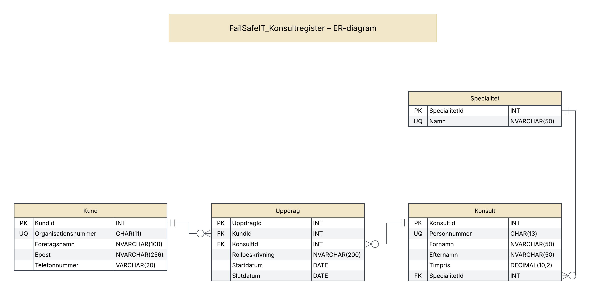

# FailSafe IT

Relationsdatabas för konsultbolaget FailSafe IT som hanterar kunder, konsulter och uppdrag.
Inlämningsuppgift 1 i kursen Databashantering (KYH, DevSecOps).

## Köra skriptet
1. Anslut till `(localdb)\mssqllocaldb` i SSMS.
2. Öppna `sql/failsafe_it.sql` och kör hela skriptet (F5).

## Datamodell

## Normalisering
**1NF – atomära värden och unik nyckel.** Varje kolumn innehåller ett enda värde. Konsultens namn är uppdelat i `Fornamn` och `Efternamn`, och en kund med flera uppdrag lagras som flera rader i `Uppdrag` i stället för som en lista i en cell. Varje tabell har en primärnyckel som unikt identifierar varje rad.

**2NF – inga partiella beroenden.** Alla tabeller har en primärnyckel som består av en enda kolumn (`INT IDENTITY`), så inget attribut kan bero på bara en del av nyckeln. Relationen mellan kund och konsult (M:N) har lösts upp med tabellen `Uppdrag`, som bara innehåller det som hör till själva uppdraget: datum, rollbeskrivning och främmande nycklar till kund och konsult.

**3NF – inga transitiva beroenden.** Ingen kolumn beror på en annan kolumn som inte är nyckel. Om till exempel kundens företagsnamn hade lagrats i `Uppdrag` hade det berott på `KundId` i stället för på `UppdragId`, och ett namnbyte hade behövt uppdateras på flera rader. Därför lagras varje uppgift på ett enda ställe och nås via främmande nycklar. Specialiteter ligger dessutom i en egen tabell, så att varje specialitet bara stavas på ett ställe.

## DevSecOps-reflektion
**Sec – SQL injection:** Webbapplikationen ska alltid skicka användarens inmatning som parametrar (till exempel `SqlParameter` i ADO.NET eller anrop till stored procedures), så att inmatningen behandlas som ett värde och aldrig körs som SQL-kod. Applikationen ansluter dessutom med en egen databasanvändare enligt principen om minsta behörighet. Den saknar rätt att ta bort tabeller eller databasen, så skadan begränsas även om ett angrepp skulle lyckas.

**Ops – Prestanda:** Sökningar på organisationsnummer kräver ett index på kolumnen. `UNIQUE`-constrainten på `Kund.Organisationsnummer` skapar automatiskt ett sådant index, så SQL Server kan göra en snabb Index Seek i stället för att läsa igenom hela tabellen (Table Scan). När tabellerna växer bör även främmande nycklar som `Uppdrag.KundId` få egna index, så att JOINs och FK-kontroller förblir snabba.